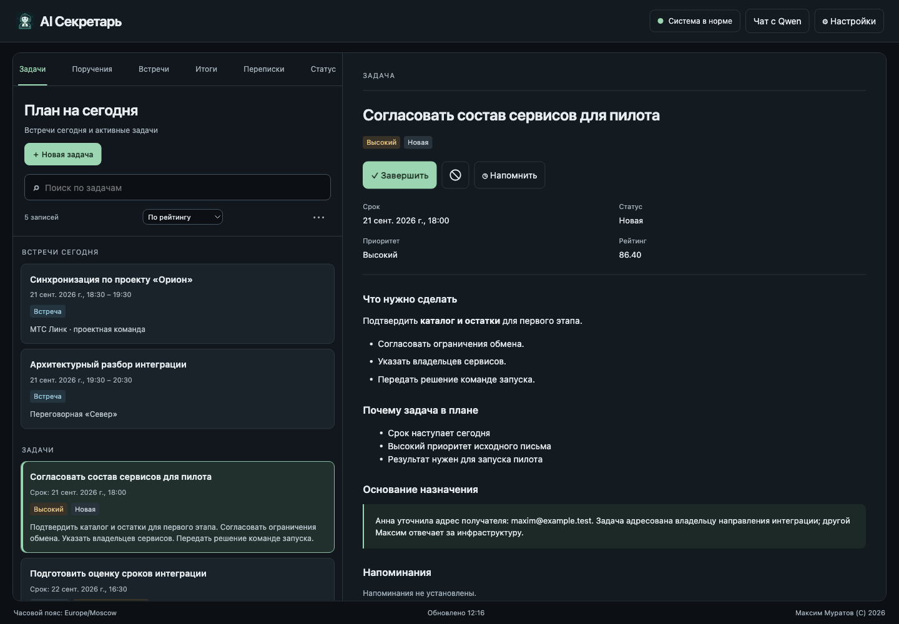
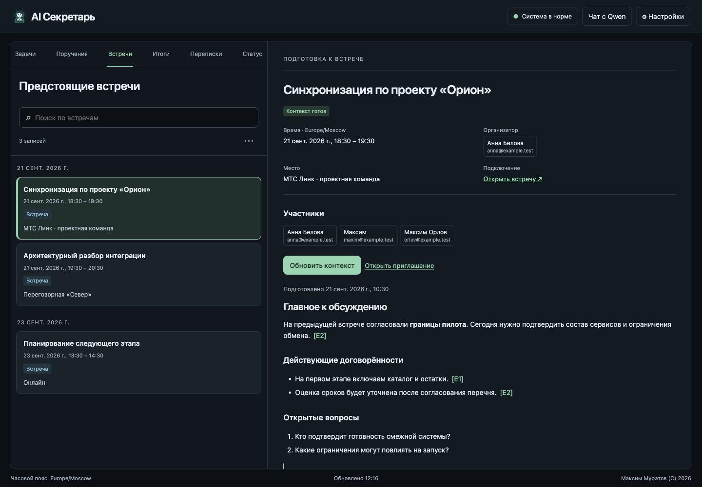
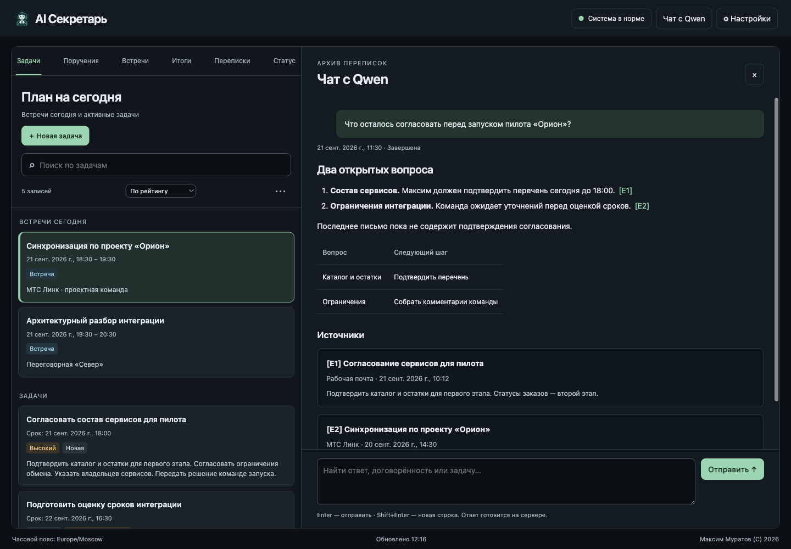
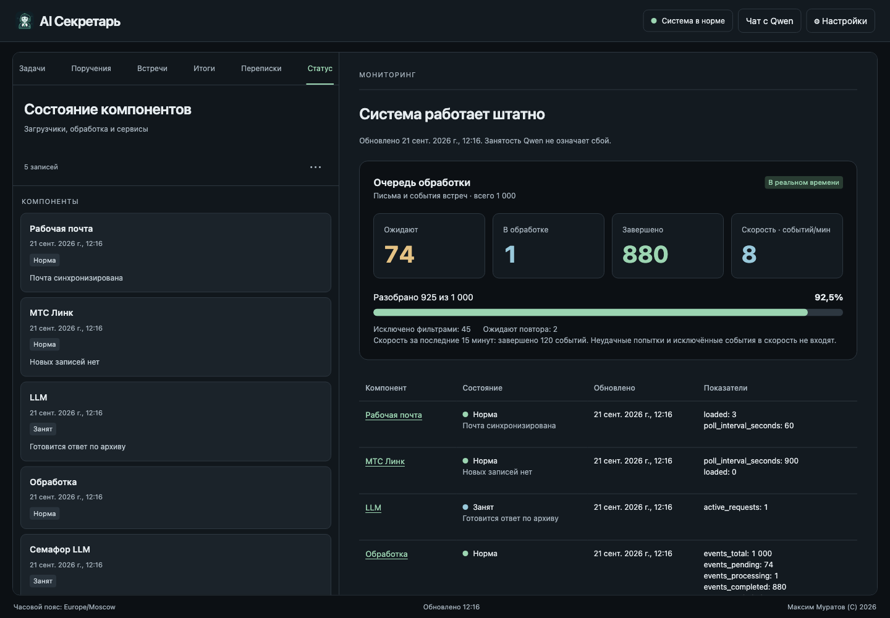
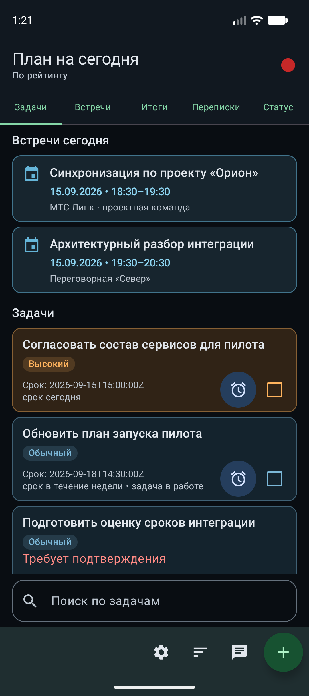
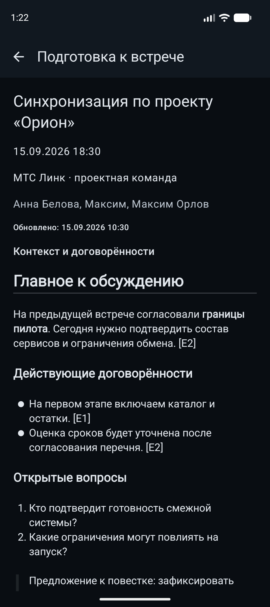
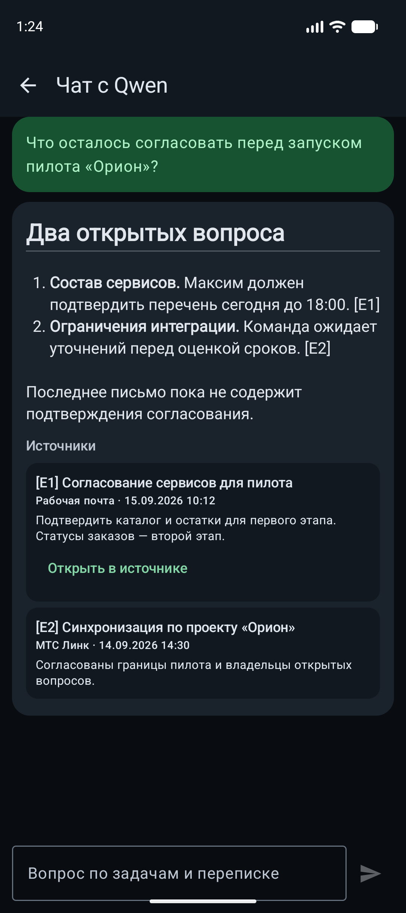

  

<h1 align="center">Серкетарь</h1>

  <strong>Персональный AI-секретарь, который хранит ваши секреты у вас.</strong> 
  Превращает почту, переписки и встречи в понятные задачи, следит за сроками
  и помогает не терять договорённости.

  Почта · встречи · задачи · поручения · личный архив

---

## Переписка заканчивается. Обязательства остаются

Рабочая задача редко приходит как аккуратно оформленная карточка в таск-трекере.
Чаще она спрятана в длинном письме, упомянута в чате, сформулирована одной фразой
на встрече или появляется в присланных после неё итогах. Затем начинаются поиски:
кто что обещал, когда это нужно сделать и был ли уже отправлен ответ.

**Серкетарь** собирает этот разрозненный поток в единую персональную картину дня.
Выбранная AI-модель понимает контекст, выделяет поручения именно для владельца системы,
определяет приоритет и срок, а Android-приложение превращает результат в удобный
список действий.

Это не ещё один почтовый клиент и не обычный список дел. Это связующее звено между
разговором и выполнением.

## Что берёт на себя Серкетарь

| Возможность | Что получает пользователь |
|---|---|
| **Задачи из переписки** | Поручения из писем и сообщений автоматически превращаются в задачи со ссылкой на оригинал. |
| **Контроль уверенности** | Очевидное поручение создаётся сразу, неоднозначное сначала предлагается подтвердить. |
| **План на сегодня** | В 08:00 готов ранжированный список с учётом приоритета, срока и просрочки. |
| **Контроль выполнения** | Ответ в переписке может перевести задачу в состояние «возможно выполнена», а окончательное решение остаётся за пользователем. |
| **Встречи и договорённости** | Предстоящие встречи, расшифровки и присланные участниками итоги собраны в связанных представлениях. |
| **Живые резюме переписок** | Каждая нитка получает краткое резюме, которое обновляется вместе с новыми сообщениями. |
| **Поиск и диалог с архивом** | Чат с AI отвечает по архиву и сохраняет контекст в отдельных разговорах. |
| **Умные уведомления** | На телефоне видно тип события, название и краткое описание задачи; нажатие открывает её детали. |
| **Голосовой ввод** | Долгое нажатие на `+` позволяет надиктовать задачу вместе со сроком и приоритетом. |

Серкетарь различает ваши задачи и поручения, которые вы дали другим. Если из
сообщения неясно, кто отвечает за действие, система предлагает проверить
назначение. Из карточки всегда можно вернуться к исходному письму или встрече.

## Веб-интерфейс

Задачи, встречи, переписки и поиск по архиву доступны в браузере. Вы видите
одни и те же данные на компьютере и телефоне.

Слева остаются вкладки, поиск и список. Выбор записи обновляет область чтения
справа, как в Outlook. Панели прокручиваются независимо. Поиск выполняется по
серверному архиву, а выбранная запись и запрос сохраняются в ссылке страницы.
На узком экране двухпанельная компоновка сохраняется с горизонтальной прокруткой.

Скриншоты показывают демонстрационные данные. Имена, адреса, сообщения и
показатели не относятся к рабочему архиву.

**Задачи и основание назначения.** Приоритет, срок, причины ранжирования и
первоисточник доступны рядом со списком. Задачу можно создать, подтвердить,
отклонить, завершить или добавить напоминание.
От задачи можно отказаться, в том числе после подтверждения или начала работы.
Она исчезнет из активного плана, а напоминания по ней прекратятся.

**Подготовка к встрече.** Контекст содержит решения, открытые вопросы и ссылки
на материалы. Будущая встреча готовится по кнопке; готовый контекст можно обновить.
Предыдущая версия остаётся доступной во время подготовки новой.

**Диалог с архивом.** Можно спросить о письмах, сообщениях, задачах и встречах.
Ответ сопровождается ссылками на источники, чтобы его было легко проверить.

**Состояние обработки.** Видно, загружаются ли новые сообщения и когда
завершится обработка ожидающих событий.

Списки и детали обновляются по мере появления новых данных. Поиск и выбранную
запись можно сохранить в ссылке и открыть позже.

## Мобильный интерфейс

Ниже — примеры планирования дня, подготовки к встрече и поиска в приложении
для Android на демонстрационных данных.

  
  
  

Уведомления помогают заметить новые важные задачи и открыть их детали.

## Один поток — от сообщения до результата

Письмо или встреча становятся задачей только тогда, когда в них есть действие
для вас. Если назначение неоднозначно, вы можете его проверить. В плане на
сегодня остаются дела, которые действительно требуют внимания.

Система сохраняет происхождение решения. Из карточки задачи можно перейти к
исходному письму или сообщению, увидеть автора, тему, дату, время и доказательный
фрагмент. Резюме помогает быстро вспомнить контекст, а оригинал позволяет проверить
вывод модели.

## Рабочий день без ручной сортировки

Утром Серкетарь формирует план на сегодня. В течение дня новые критические задачи
сразу попадают в него, приближающиеся сроки поднимаются выше, а незавершённые задачи
на следующий рабочий день ранжируются заново.

Сроки понимаются не только как календарные даты. Формулировки вроде «завтра»,
«к пятнице» или «до конца дня» интерпретируются в настроенном часовом поясе, в
границах рабочего времени и с учётом производственного календаря России.

Пользователь при этом сохраняет контроль: задачу можно создать или отредактировать
вручную, назначить напоминание, изменить приоритет и подтвердить выполнение.

## Встреча не заканчивается на последнем слайде

Серкетарь отделяет календарные события от обычной переписки и связывает материалы
одной встречи:

- событие из календаря Outlook;
- расшифровку МТС Линк;
- автоматически сформированное выбранной AI-моделью резюме;
- решения и договорённости;
- присланные участниками письма с итогами;
- задачи, которые появились по результатам обсуждения.

На плитке видна короткая выжимка, а в деталях — время, тема, участники, общее резюме
и отдельные комментарии участников. Повторяющиеся встречи учитываются как реальные
экземпляры календаря, а будущая встреча не может случайно оказаться среди итогов.

## Модели, поиск и память

Qwen3 4B, 8B, 14B и 32B загружаются по кнопке «Загрузить» и работают во
встроенной llama.cpp. Движок использует Metal на macOS, CUDA или Vulkan на
Windows; в Docker/Linux доступны GPU-конфигурации Vulkan и CUDA. При
недоступности GPU модель может работать на CPU.

Модели подключаются как отдельные источники. Для каждого вида анализа можно
назначить последовательный каскад с собственными параметрами. Временная
недоступность модели сохраняет текущий шаг каскада до повторной попытки.

Для смыслового поиска можно выбрать встроенную EmbeddingGemma 2 или внешний
совместимый API эмбеддингов. Подтверждённая личная и проектная память помогает
учитывать ранее принятые решения при автоматическом анализе писем, задач и
поручений. В чате можно создавать отдельные разговоры, задавать уточняющие
вопросы и удалять историю выбранного разговора.

## Приватность — часть архитектуры

Серкетарь создан для личного использования с собственным сервером. Рабочий
архив остаётся в вашей среде. Для анализа можно выбрать локальную модель или
внешний AI-сервис. При выборе внешнего сервиса необходимые для анализа данные
передаются ему.

## Подключаемые источники

Серкетарь собирает рабочий контекст из:

- рабочей почты, включая входящие и отправленные сообщения;
- Microsoft Exchange;
- календарь Outlook, в том числе повторяющиеся встречи;
- готовые расшифровки МТС Линк;
- текстовых вложений к письмам.

Источники подключаются через веб-панель. Там же настраиваются проекты, исключённые
адреса и стоп-фразы, параметры локальной модели, рабочий календарь и уведомления.
Рассылки, ответы о принятии встреч и автоответы об отсутствии распознаются отдельно,
чтобы не засорять задачи и рабочие переписки.

## Для кого этот продукт

Серкетарь особенно полезен руководителям, архитекторам, владельцам продуктов,
консультантам и специалистам, у которых решения распределены между несколькими
почтовыми ящиками и регулярными встречами, а цена забытой договорённости выше цены
ручного ведения ещё одного списка.

Продукт рассчитан на личный рабочий контекст, которым удобно пользоваться
в браузере и приложениях для macOS, Windows, iPhone и Android.

## Чем отличается от обычного таск-трекера

| Обычный список задач | Серкетарь |
|---|---|
| Ждёт ручного ввода | Находит обязательства в уже существующей коммуникации |
| Хранит только карточку | Сохраняет связь с исходным контекстом и оригиналом |
| Не понимает, был ли дан ответ | Отслеживает продолжение переписки и признаки выполнения |
| Показывает заданный порядок | Повторно ранжирует задачи по важности и сроку |
| Отделён от встреч | Связывает календарь, расшифровку, итоги и поручения |
| Часто зависит от облачного AI | Запускает Qwen во встроенной llama.cpp или подключает внешние модели |

[Узнать больше о Серкетаре](https://ai-secretary.co) · [Смотреть выпуски](https://github.com/mumg/ai_secretary_releases/releases)
